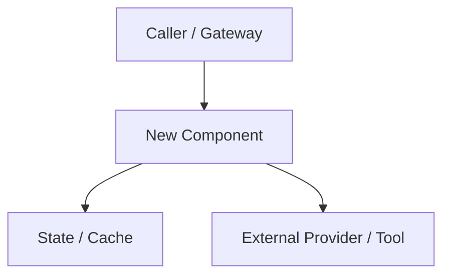

# Technical Design: [Feature Name]

* **Associated Spec**: [01-spec.md](./01-spec.md)
* **Status**: Draft | Approved | In Progress | Completed
* **Architect**: [Name / Agent]
* **Target Revision**: [Git commit or branch]

---

## 1. Architecture Overview & Component Boundaries
Explain how this feature integrates into the existing codebase without violating clean architecture principles or core invariants.



---

## 2. Public Interfaces & Contracts
Detail exact class names, methods, signatures, and type annotations.

```python
class FeatureHandler:
    """Handles the lifecycle of [Feature]."""

    def __init__(self, config: dict[str, Any]) -> None:
        ...

    def execute(self, payload: RequestPayload) -> ResponseResult:
        """Executes domain action.
        
        Raises:
            ValidationError: If payload violates schema.
            OperationalError: If underlying system call fails.
        """
        ...
```

---

## 3. Data Schema & State Invariants
* Data structures, Pydantic / dataclass schemas, or database tables.
* Serialization / deserialization rules.
* Concurrency considerations (file locks, SQLite WAL checkpoints, etc.).

---

## 4. Trade-Offs & Alternatives Considered
* **Approach A (Selected)**: Why it was chosen, benefits, drawbacks.
* **Approach B (Discarded)**: Why it was rejected (e.g., higher latency, broken prompt cache, added dependencies).

---

## 5. Observability & Error Handling
* Structured logging patterns (levels: INFO, WARNING, ERROR).
* Error categorization and recovery strategies.

---

## 6. Skill Pattern Compliance
* **Referenced Skills**: List the `.skills/<skill>/SKILL.md` files consulted during design.
* **Enforced Patterns**: Document alignment with `api-and-interface-design` and `code-review-and-quality` (strict typing, zero prompt-cache invalidation, atomic state updates).
* **Anti-Patterns Avoided**: Explicitly list anti-patterns avoided.

