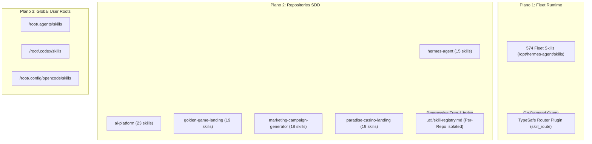

# Technical Design: Canonical Skills Rollout & Hardening

* **Associated Spec**: [01-spec.md](./01-spec.md)
* **Status**: Approved
* **Architect**: Senior Architect (Antigravity) / Peer Review: Codex
* **Target Revision**: HEAD / `fix/cron-dispatch-ack-ledger`

---

## 1. Architecture Overview & Component Boundaries

The skills ecosystem spans three architectural planes:
1. **Plano 1 (Fleet Runtime)**: `/opt/hermes-agent/skills/` (574 skills catalog, routed on-demand via `typesafe-skill-router` plugin).
2. **Plano 2 (Repositories SDD)**: `<repo>/.agents/skills/` (15-23 stack skills per repo), indexed locally by `.atl/skill-registry.md`, mirrored to `.claude/skills/`.
3. **Plano 3 (CLI Roots)**: `/root/.agents/skills/`, `/root/.codex/skills/`, `/root/.config/opencode/skills/`.



---

## 2. Defensive Security Specification: `template.sh` (`write_env`)

### Threat Model
1. **Symlink Traversal**: An attacker or rogue script creates a symlink `../../.env -> /etc/shadow` or `~/.bashrc`. If a wizard script writes without checking symlink flags, it clobbers system files and alters permissions.
2. **Identifier Injection**: Unsanitized key strings containing `=`, newlines, or command separators corrupt grep patterns or generate invalid environment variables.
3. **Interrupted Writes**: Non-atomic redirection (`cat > file`) can result in a zero-length or truncated `.env` if terminated mid-write.

### Design Contract
```bash
write_env() {
  local key="$1" value="$2" tmp sq="'\\''" target_dir

  # Invariant 1: Reject directories unconditionally
  if [[ -d "$ENV_FILE" ]]; then
    printf '  %s✗ ERROR: %s is a directory. ENV_FILE must be a regular file path.%s\n' "${RED:-}" "$ENV_FILE" "${RESET:-}" >&2
    return 1
  fi

  # Invariant 2: Reject symlinks unconditionally
  if [[ -L "$ENV_FILE" ]]; then
    printf '  %s✗ ERROR: %s is a symbolic link. Writing secrets through symlinks is prohibited for security.%s\n' "${RED:-}" "$ENV_FILE" "${RESET:-}" >&2
    return 1
  fi

  # Invariant 3: Validate POSIX variable identifier format
  if [[ ! "$key" =~ ^[A-Za-z_][A-Za-z0-9_]*$ ]]; then
    printf '  %s✗ ERROR: Invalid variable identifier "%s". Must match POSIX format ^[A-Za-z_][A-Za-z0-9_]*$%s\n' "${RED:-}" "$key" "${RESET:-}" >&2
    return 1
  fi

  # Invariant 4: Ensure parent directory exists with safe permissions
  target_dir=$(dirname "$ENV_FILE")
  [[ -d "$target_dir" ]] || mkdir -p "$target_dir"

  # Invariant 5: Create temp file in same directory to guarantee atomic rename on same filesystem
  tmp=$(mktemp "${target_dir}/.env.tmp.XXXXXX" 2>/dev/null || mktemp)
  chmod 0600 "$tmp" 2>/dev/null || true
  if [[ -f "$ENV_FILE" ]]; then
    grep -vE "^${key}=" "$ENV_FILE" > "$tmp" || true
  fi
  printf "%s='%s'\n" "$key" "${value//\'/$sq}" >> "$tmp"

  # Invariant 5: Atomic replacement
  chmod 0600 "$tmp" 2>/dev/null || true
  mv -f "$tmp" "$ENV_FILE"
  chmod 0600 "$ENV_FILE" 2>/dev/null || true

  printf -v "$key" '%s' "$value"
  WRITTEN_ENV+=("$key")
  printf '  %s✓ wrote%s %s → %s (mode 0600, atomic)\n' "$GREEN" "$RESET" "$key" "$ENV_FILE"
}
```

---

## 3. Worktree Isolation Policy

1. **Independent State**: Each git worktree represents a discrete checkout of a branch.
2. **No Symlinked `.atl`**: Symlinking `.atl` across worktrees violates branch isolation. Each worktree must have its own `.atl/` directory if indexed.
3. **No Blind Ownership Mutations**: Never execute `chown -R` across worktrees unless an active operational task demonstrates an `EACCES` permission failure with concrete logs.

---

## 4. Verification Framework

The verification framework employs strict tiering:
1. **Tier 1 (Unit)**: `bash tests/test_template_hardening.sh` testing `write_env` against symlinks, bad keys, quotes, and atomicity.
2. **Tier 2 (Static Parser)**: Python script executing `skill_manager_tool._validate_frontmatter` across all 574 catalog entries.
3. **Tier 3 (Plugin Integration)**: `test_skill_route_live_probe.py` verifying that `typesafe-skill-router` correctly loads and routes against `codebase-design` and `wizard`.
4. **Tier 4 (Audit Closure)**: Update `PROJECT_MEMORY.md` across repositories and record memory in Engram.
