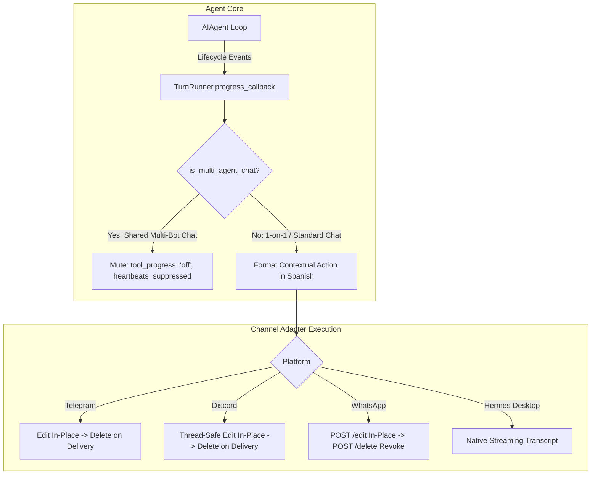

# Technical Design: Ephemeral Contextual Progress & Multi-Channel Cleanup

* **Associated Spec**: [01-spec.md](./01-spec.md)
* **Status**: Approved; implementation and authorized local activation verified; delivery closure pending
* **Architect**: Antigravity (Senior Architect)
* **Target Revision**: `feat/ephemeral-progress-heartbeat-cleanup`

---

## 1. Per-Channel Architecture & Uniform Standard



---

## 2. Key Components

### 2.1. WhatsApp Baileys Bridge Revoke (`POST /delete`)
* **Endpoint**: `POST /delete` in `scripts/whatsapp-bridge/bridge.js`
* **Implementation**:
  ```javascript
  const key = {
    remoteJid: chatId,
    fromMe: true,
    id: messageId,
  };
  await sock.sendMessage(chatId, { delete: key });
  ```
* **Adapter Integration**: `WhatsAppAdapter.delete_message(chat_id, message_id)` routes to bridge `POST /delete`.

### 2.2. Discord Thread-Safe Deletion
* When `chat_id` is a parent channel and the message exists in a thread, `delete_message` queries thread channel context to prevent 404 Unknown Message.

### 2.3. Buffer Replacement (`gateway/run_turn_runner.py`)
* `_progress_absorb`: When `tool_progress_grouping: replace`, `st.progress_lines = [line]` overwrites the buffer instead of appending.

### 2.4. Multi-Agent Anti-Loop Safeguard (`gateway/display_config.py`)
* Function `is_multi_agent_chat(source, user_config, adapter)` evaluates:
  1. `source.chat_id`, `source.thread_id`, or `source.parent_chat_id` in `display.multi_agent_channels` / `display.multi_agent_chats`.
  2. Discord `adapter._discord_thread_require_mention()` where multiple bots share threads.
* In `run_turn.py`, turns matching `is_multi_agent_chat` force `tool_progress_enabled = False` and mute long-running notifications.

### 2.5. Shared Replace-Mode Status Writer (`gateway/run_turn.py`, `gateway/run_turn_runner.py`)
* The long-running heartbeat producer formats duration/action text and puts a typed status update on the existing per-turn `progress_queue`; it does not call the delivery adapter directly.
* The existing `TurnRunner.send_progress_messages` task owns the single `_ProgressEditState` for tool progress and heartbeat status. Status metadata is carried by the queue item; ordinary tool events continue using progress metadata.
* Queue creation includes turns with enabled long-running notifications even when tool progress is off. Existing mode gates, generation checks, task-card lane, rate limiting, interruption, cancellation, and final cleanup remain in force.
* In `replace` mode, adapters without edit support send at most one initial status bubble; a permanent edit failure suppresses later heartbeat and tool-status sends because the original bubble may still exist. Other progress grouping modes retain their prior behavior.
* Flood-cap edit failures preserve the existing message ID and honor a bounded retry-after interval; they do not fall through to a new send. Only the writer tracks successful message IDs for the existing post-final cleanup path, preventing separate heartbeat/tool message identities.
* The native Slack task-card consumer recognizes typed heartbeat items as a stable in-progress status row in the current card projection and text fallback; it does not create a parallel writer or bubble.

---

## 3. Configuration Hierarchy & Fleet Standardization
The root configuration records shared channel-policy defaults in `/opt/hermes-agent-data/config.yaml`:
```yaml
display:
  language: es
  multi_agent_channels:
    - "1562442815676616704"  # digital-vikings
  platforms:
    telegram:
      tool_progress: 'new'
      tool_progress_grouping: replace
      cleanup_progress: true
      busy_ack_detail: false
    discord:
      tool_progress: 'new'
      tool_progress_grouping: replace
      cleanup_progress: true
      busy_ack_detail: false
    whatsapp:
      tool_progress: 'new'
      tool_progress_grouping: replace
      cleanup_progress: true
      busy_ack_detail: false
agent:
  gateway_notify_interval: 20
```
Profiles do not automatically inherit the root config. Effective settings resolve from the active home file through environment expansion, managed overlay, and normalization. Root and 11 profile display blocks are replicated deliberately; a shared display policy does not imply that each profile adapter is enabled.


### 3.1. WhatsApp Shared Transport and Profile Routing

The root/default gateway owns the connected WhatsApp receiving adapter and bridge. `gateway.profile_routes` selects the logical profile for an inbound contact; outbound delivery continues through the receiving adapter that accepted the message.

| Route family | Logical profile | Accepted match forms |
|---|---|---|
| `chucho-wa` | Roshi | LID, JID, phone number |
| `jonathan-wa` | default/Ragnar | LID, JID, phone number |

The six enabled rules (three forms per route family) were validated against current configuration and runtime matcher. They preserve the existing pairing, WhatsApp number, and bridge. Roshi is hosted by the root multiplex; its separate WhatsApp adapter is intentionally disabled. Do not enable another adapter, link another number, or request a QR for these existing routes. No fresh end-to-end inbound contact canary has been performed.
