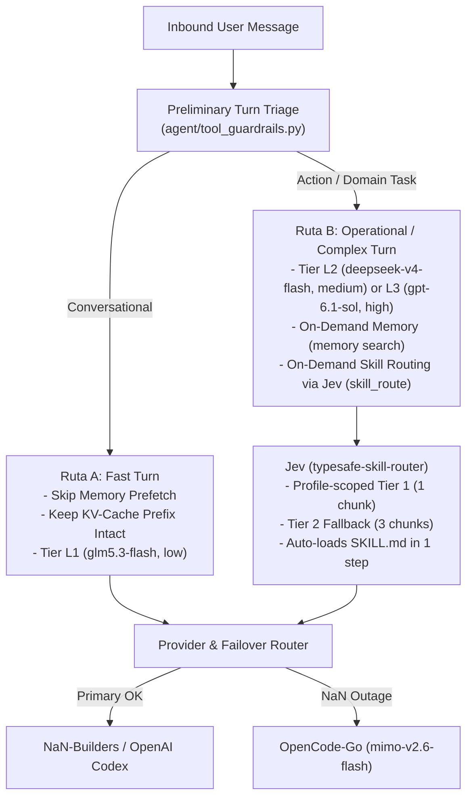

# Technical Design: Fleet Latency, Zero-Default-Load Routing & Model Specialization

* **Associated Spec**: [01-spec.md](./01-spec.md)
* **Status**: Approved
* **Architect**: Argon / Senior Architect
* **Target Revision**: `feat/ephemeral-progress-heartbeat-cleanup` (`cd397afc64`)

---

## 1. Architecture Overview & Component Boundaries



---

## 2. Public Interfaces & Contracts

### 2.1 Zero-Default-Load Memory Index (`tools/memory_tool_store.py`)
Allow `index_char_limit: 0` when `on_demand: true` so zero entries of `MEMORY.md` are injected into the Turn-1 System Prompt:

```python
class MemoryStore:
    def __init__(
        self,
        memory_char_limit: int = 2200,
        user_char_limit: int = 1375,
        *,
        memory_enabled: bool = True,
        user_profile_enabled: bool = True,
        on_demand: bool = False,
        index_char_limit: int = 0,
    ):
        ...
        raw_idx_limit = 0 if index_char_limit is None else int(index_char_limit)
        self.index_char_limit = 0 if raw_idx_limit <= 0 else max(500, raw_idx_limit)

    def _render_compact_index(self, entries: list[str]) -> str:
        """Render a zero-entry on-demand pointer when index_char_limit == 0, else bounded topic index."""
        if not entries:
            return ""
        full_content = ENTRY_DELIMITER.join(entries)
        sep = "═" * 46
        title = MEMORY_BLOCK_HEADERS["memory"]
        usage_str = self._usage_pct("memory", len(full_content))
        header = (
            f"{sep}\n"
            f"{title} [ON-DEMAND STORE — {len(entries)} entries, {usage_str}]\n"
            f"{sep}\n"
            "On-Demand Memory Active: Entries are not preloaded on Turn 1 to keep context minimal.\n"
            "- Search by topic/keyword: `memory(action=\"search\", target=\"memory\", content=\"<query>\")`\n"
            "- Read entry by index: `memory(action=\"read\", target=\"memory\", content=\"#<index>\")`"
        )
        if self.index_char_limit <= 0:
            return header
        ...
```

### 2.2 KV-Cache-Safe Turn Triage (`agent/tool_guardrails.py` & `agent/turn_context.py`)
1. In `agent/turn_context.py:_memory_turn_start_and_prefetch`:
   ```python
   from agent.tool_guardrails import is_conversational_turn
   if not is_trivial_prompt(_query) and not is_conversational_turn(_query):
       ext_prefetch_cache = agent._memory_manager.prefetch_all(_query, session_id=agent.session_id) or ""
   ```
2. In `agent/tool_guardrails.py:should_decouple_tools_for_turn`:
   - Never decouple (`return False`) when `len(messages) > 2` (i.e., any multi-turn session where `agent.tools` is already part of the provider's cached prefix).
   - On Turn 1 (`len(messages) <= 2`), only decouple when the message is a short unambiguous greeting/ack (<60 chars, no `?`/`¿`, no capability/meta queries).

### 2.3 Jev (`typesafe-skill-router`) Contextual Routing & Stage-2 Margin Fix
1. **Profile Home Resolution (`__init__.py`)**:
   Use `hermes_constants.get_hermes_home()` inside `hermes_home()` so multiplexed gateway workers resolve the bound profile's `HERMES_HOME`.
2. **Stage-2 Tie/Margin Handling (`typesafe_router/router.py`)**:
   - In `rank_wide()`: only append `GATE_QUESTIONS` when `enforce_gate=True`.
   - In `suggest()`: when `winner` is chosen (`winner_fits >= fits_threshold`) and `best_name != winner` with `best_fits - winner_fits < fits_margin`:
     - If `winner_fits >= fits_threshold`, keep `winner` as primary and include `best_name` as secondary (`names = (winner, best_name)`) instead of discarding both (`names = ()`).
     - If `winner is None` and `not enforce_gate` (explicit `skill_route` tool call) and `best_fits >= fits_threshold`, select `(best_name,)`.

### 2.4 Dynamic Complexity Tiering & `OpenCode-Go` Failover Preservation (`agent/turn_request_assembly.py`)
```python
def apply_dynamic_turn_tiering(agent: Any, messages: list[Any], tool_turns: int = 0) -> None:
    """Adjust per-turn model and reasoning_effort for profiles with dynamic_tiering enabled (default, roshi).
    Never overrides an active provider failover (e.g. OpenCode-Go) or explicit session model override.
    """
```
- **Failover Invariant**: If `getattr(agent, "_fallback_activated", False)` is `True` or `str(getattr(agent, "provider", "")).lower() in {"opencode-go", "opencode", "zen"}`, `apply_dynamic_turn_tiering` keeps the provider on `OpenCode-Go` (`mimo-v2.6-flash` for L1/L2, `deepseek-v4-flash` on `OpenCode-Go` for L3).
- **Session Override Invariant**: If the session has an explicit `/model` session override (`getattr(agent, "_session_model_pinned", False)`), dynamic tiering respects the session pin.

### 2.5 Config Shield (`hermes_cli/web_server_config.py` & `scripts/hooks/guard_config_model_mutation.py`)
1. `scripts/hooks/guard_config_model_mutation.py`: Pre-tool-call hook registered across profiles that blocks `terminal`, `execute_code`, `write_file`, and `patch` calls attempting to run `hermes config set model...` or edit `model:` in `config.yaml`, instructing the agent to recommend `/model <name>` (session-scoped).
2. `hermes_cli/web_server_config.py`: When `model.lock_default_in_config: true` is set in `config.yaml` and `persist_global` is not explicitly requested, `set_configured_model` records a session/runtime override without overwriting `model.default` on disk.

---

## 3. Data Schema & State Invariants

### Per-Profile Model & Fallback Matrix (`config.yaml` & `fleet_model_policy.json`)
| Profile | Primary Provider | `model.default` | `reasoning_effort` | `fallback_model[0]` (`NaN-Builders`) | `fallback_model[1]` (`OpenCode-Go`) |
|---|---|---|---|---|---|
| `default` (Ragnar) | `NaN-Builders` (Dynamic L1/L2/L3 w/ Codex L3) | `deepseek-v4-flash` | `medium` (dynamic `low`..`high`) | `NaN-Builders` / `glm5.3-flash` | `OpenCode-Go` / `mimo-v2.6-flash` |
| `roshi` | `NaN-Builders` (Dynamic L1/L2/L3 w/ Codex L3) | `deepseek-v4-flash` | `medium` (dynamic `low`..`high`) | `NaN-Builders` / `glm5.3-flash` | `OpenCode-Go` / `mimo-v2.6-flash` |
| `brokkr` | `NaN-Builders` | `deepseek-v4-flash` | `medium` | `NaN-Builders` / `glm5.3-flash` | `OpenCode-Go` / `mimo-v2.6-flash` |
| `heimdall` | `NaN-Builders` | `deepseek-v4-flash` | `medium` | `NaN-Builders` / `glm5.3-flash` | `OpenCode-Go` / `mimo-v2.6-flash` |
| `sindri` | `NaN-Builders` | `qwen3.8-flash` | `low` | `NaN-Builders` / `deepseek-v4-flash` | `OpenCode-Go` / `mimo-v2.6-flash` |
| `ullr` | `NaN-Builders` | `qwen3.8-flash` | `low` | `NaN-Builders` / `deepseek-v4-flash` | `OpenCode-Go` / `mimo-v2.6-flash` |
| `vili` | `NaN-Builders` | `qwen3.8-flash` | `low` | `NaN-Builders` / `deepseek-v4-flash` | `OpenCode-Go` / `mimo-v2.6-flash` |
| `bragi` | `NaN-Builders` | `mimo-v2.6-flash` | `low` | `NaN-Builders` / `deepseek-v4-flash` | `OpenCode-Go` / `mimo-v2.6-flash` |
| `freyja` | `NaN-Builders` | `glm5.3-flash` | `low` | `NaN-Builders` / `deepseek-v4-flash` | `OpenCode-Go` / `mimo-v2.6-flash` |
| `hermodr` | `NaN-Builders` | `glm5.3-flash` | `low` | `NaN-Builders` / `deepseek-v4-flash` | `OpenCode-Go` / `mimo-v2.6-flash` |
| `vigia` | `NaN-Builders` | `glm5.3-flash` | `low` | `NaN-Builders` / `deepseek-v4-flash` | `OpenCode-Go` / `mimo-v2.6-flash` |
| `comms` | `NaN-Builders` | `glm5.3-flash` | `low` | `NaN-Builders` / `deepseek-v4-flash` | `OpenCode-Go` / `mimo-v2.6-flash` |

---

## 4. Trade-Offs & Alternatives Considered
* **Approach A (Selected — Input-Layer Prevention + Local CPU Complexity Triage + Zero-Default-Load)**:
  - Keeps the System Prompt and `tools_for_api` byte-stable across turns, preserving 100% of provider KV-cache hits, eliminating 6,000 chars of Turn-1 `MEMORY.md` index bloat, and preventing capability hallucinations before the LLM is called.
* **Approach B (Discarded — Mid-Session `tools_for_api = []` + Output-Side `capability-claim-guard`)**:
  - Stripping tools mid-session destroys the provider KV-cache (causing 54s prefill latency on 64k-token transcripts) and causes the LLM to hallucinate lack of capability, which then requires an expensive output-side retry loop (`capability-claim-guard`). Discarded as over-engineering.

---

## 5. Observability & Error Handling
* `typesafe-skill-router.log` records `profile=<active_profile>` and `tier=tier1|tier2|global` with elapsed time and cache hit counters.
* `agent.conversation_loop` logs dynamic tier transitions (`Turn complexity triage: tier=L1|L2|L3 model=<model> effort=<effort>`).

---

## 6. Skill Pattern Compliance
* **Referenced Skills**:
  - `.skills/api-and-interface-design/SKILL.md`
  - `.skills/code-review-and-quality/SKILL.md`
  - `.skills/systematic-debugging/SKILL.md`
* **Enforced Patterns**: Backward-compatible schemas (`query` + optional `context` in `skill_route`), byte-stable prompt-cache prefixes, atomic file updates, and fail-open fallback to `OpenCode-Go` (`mimo-v2.6-flash`).
