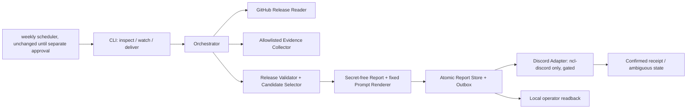

# Hermes Safe Update Controller — Technical Design

**Status:** Phase 2 approved — explicit user approval (“Aprobado”) on 2026-10-28.

**Decision record:** The user approved this design with **“Aprobado”** on 2026-10-28. This approval permits Phase 3 task breakdown and test-first implementation of the approved monitoring/reporting scope; the task checklist is not a separate approval gate. It does not authorize scheduler cutover, a real Discord post, remote access, deployment, or any production operation.

## 1. Design at a glance

Build a small, standalone Python standard-library controller at the operational edge, not inside Hermes' agent core. It will use GitHub's public REST API for read-only release evidence, read-only local metadata collectors, versioned secret-free JSON reports, and the source-verified existing `ncl-discord` CLI as the sole Discord transport. The current legacy sync script remains untouched until a separately approved cutover.

The first implementation milestone is **monitoring only**: identify stable official releases; record immutable release and explicitly unknown environment facts; render one fixed non-authorizing prompt; and manage an auditable notification outbox. There is no live Git fetch, merge, checkout, build, backup, restart, config write, or Hermes updater invocation. Protected prepare/backup/rehearse/activate/recover operations remain separate future designs; attempting one in this controller returns `unsupported` with a blocker, never a synthetic success.

| Question | Decision |
|---|---|
| Where does it live? | `scripts/hermes-update-watch.py` entry point plus `scripts/hermes_update_watch/` package (hyphenated entry point avoids Python module/package collision); no Hermes runtime/agent imports. The package includes `process.py` for bounded shell-free subprocess execution. Contract tests are split by task: `tests/scripts/test_hermes_update_watch.py` (release discovery), `tests/scripts/test_hermes_update_watch_report.py` (evidence/reports), and future state/CLI test files. |
| Which dependencies? | Python 3.12 standard library already present on this host (`/usr/bin/python3`); `urllib`, `json`, `dataclasses`, `hashlib`, `hmac`, `uuid`, `selectors`, `subprocess`, and POSIX `fcntl`. No dependency or binary additions. The installer must verify the chosen interpreter and must not bootstrap/install one. |
| What does a check read? | Fixed GitHub API endpoints for `NousResearch/hermes-agent` and an explicit allowlist of local, secret-free facts. PROD stays `unknown` unless separately authorized read-only evidence is supplied; no ambient SSH or remote probes. |
| What can write/send? | `watch` writes only controller-owned reports/state outside the checkout. `deliver` uses the source-verified `ncl-discord` CLI only after a separate human authorization names the exact destination, profile, and send operation. |
| What does “verified” mean? | A published, non-draft, non-prerelease release object from the fixed official repository whose stable tag resolves to one immutable commit SHA. This establishes source/release identity, not cryptographic author attestation, compatibility, safety, or authorization. |

## 2. Boundaries and components



All modules return typed results; only the orchestrator coordinates them. There is one real transport adapter (the existing CLI) and one fake in tests, so do not introduce a generic plugin/adapter framework. Keep release interpretation and state transitions inside this module; CLI arguments are thin and do not duplicate policy.

### Public function surface

```python
def inspect(config: WatchConfig, clients: WatchClients) -> InspectResult: ...
def record_watch(config: WatchConfig, clients: WatchClients, store: ReportStore) -> WatchResult: ...
def deliver(report_id: str, config: WatchConfig, store: ReportStore,
            transport: DiscordTransport) -> DeliveryResult: ...
def render_prompt(report: Report) -> str: ...
```

`inspect` is read-only: it performs no report/state write and no message send. `record_watch` records reports/outbox entries but does not send. `deliver` is the only sending operation and takes an existing report ID; it never re-discovers releases or changes report contents. The CLI exposes those verbs explicitly; there is no `--apply`, `--update`, free-form target, or protected lifecycle verb. An unsupported future operation returns a non-zero result and a stable reason code (`unsupported_operation`).

`WatchConfig` is constructed from constants plus validated explicit settings for the state root and Discord destination/profile. Controller code does not read secret files or log credential values; the existing `ncl-discord` executable owns its current credential lookup. `WatchClients` holds the release reader and evidence collector seams. `InspectResult`, `WatchResult`, and `DeliveryResult` contain a bounded status enum, report IDs/counts, and stable reason codes; they never carry unfiltered upstream text, local filenames, or command stderr to stdout/logs.

## 3. Release identity and read-only collection

### GitHub source adapter

Use anonymous HTTPS requests to the fixed host `api.github.com`, repository `NousResearch/hermes-agent`, with a fixed `User-Agent`, `Accept: application/vnd.github+json`, and `X-GitHub-Api-Version: 2022-11-28`. No credential lookup or authenticated GitHub client is needed for public releases. The client rejects non-HTTPS URLs, all HTTP redirects before following them (including same-host redirects), non-JSON responses, malformed schemas, oversized bodies (2 MiB per response), and non-2xx responses. Pagination remains supported through separately validated HTTPS links to the fixed API host; each page is an independent request counted against the run budget. Per-request timeout is 10 seconds; do not retry indefinitely. A 403/429, timeout, incomplete page sequence, or malformed response is `unavailable`/`blocked`, never “no update.” Do not include raw response bodies in logs/reports.

1. List published releases from `GET /repos/NousResearch/hermes-agent/releases?per_page=100&page=N`, following only validated same-host pagination links. Scan at most five pages (500 objects) per run. If a next page remains at the cap, return `incomplete_pagination`; do not update state or assert “no update.” Ignore drafts, prereleases, and tags that fail the strict stable parser (`vMAJOR.MINOR.PATCH`, no pre-release/build suffix, no leading-zero components); never use title/body/branch text as evidence or instructions. Release-list response bodies are parsed only for allowlisted fields and are never retained/rendered.
2. Resolve a bounded combined set of at most six identities per run: up to five selected candidate releases plus the currently observed latest stable identity when it is not already selected. Selected candidates are oldest-first after cold start; pending identities retain priority and overflow stays pending. Cold start selects the newest stable only and records older items `seen_not_notified` without resolving every historical tag. Resolve via `GET /repos/NousResearch/hermes-agent/git/ref/tags/{tag}`, accepting a direct commit or at most three annotated-tag-object hops. Reject cycles, missing objects, unsupported types, malformed SHAs, or release/ref disagreement. Persist every verified `(repository, release_id, tag, commit_sha)` identity. Repeated release ID with changed tag/SHA, or any tracked tag with changed SHA, is `identity_changed`/`tag_moved` and blocks; it cannot create a new dedupe key. If the newest selected release fails identity verification, block rather than falling back to an older release.
3. On the first **complete** scan, report and nominate the newest verified stable release once (availability only; unknown runtime version does not negate release availability). Mark older releases `seen_not_notified`, not delivered, so there is no backlog storm and no false notification watermark. On later scans, queue new eligible stable releases oldest-first by publication timestamp/ID, at most five per run; retain excess for later runs. A recreated release ID with the same tag/SHA is recorded `republished_same_identity` and does not re-alert. A changed SHA for a tracked tag blocks instead of re-alerting.

The per-run network budget is at most 29 GitHub requests: five list pages plus up to six selected/relevant tag resolutions, each with at most three annotated-tag hops. Each response is at most 2 MiB, aggregate bytes at most 14 MiB, and wall-clock deadline 90 seconds with 10-second per-request timeouts and no retries. Any cap reached before discovery/identity validation completes returns `partial`/blocked, preserves state, and never claims no update. A complete listing with one or more stable releases, all already accounted for, is `no_change`; a complete listing with no stable releases is blocked `no_verified_stable_release`.

GitHub documents that the release listing excludes ordinary tags without releases and supports pagination, while the “latest release” endpoint is based on creation date rather than publication date. Therefore the design scans published release objects instead of treating `/latest` or the newest tag name as authoritative. Git refs are mutable; pin the resolved commit SHA and compare repeat observations. The tag-object endpoint only supports annotated tags, so lightweight tags are handled by the direct commit reference and annotated tags by bounded peeling. This proves identity, not signature authenticity.

### Environment evidence collector

The collector uses an explicit target map, never arbitrary command-line strings. Its fixed argv prefix is `[/usr/bin/git, -c, core.hooksPath=/dev/null, -c, core.fsmonitor=false, -c, core.untrackedCache=false, -c, core.pager=cat, -c, core.quotePath=true, -C, /opt/hermes-agent]`; append only `rev-parse --verify HEAD^{commit}` or `status --porcelain=v1 --untracked-files=all`. Use `shell=False` and environment `{PATH:/usr/bin:/bin, HOME:/nonexistent, LC_ALL:C, GIT_CONFIG_NOSYSTEM:1, GIT_CONFIG_GLOBAL:/dev/null, GIT_OPTIONAL_LOCKS:0, GIT_TERMINAL_PROMPT:0}`. Never call fetch, diff, show, a pager, hook, fsmonitor, or external diff. Bound each process to 5 seconds; a shared small helper reads stdout/stderr concurrently in bounded chunks, terminates and reaps the child as soon as either stream exceeds 64 KiB/4 KiB, and never calls unbounded `communicate()`/`capture_output`. Parse porcelain rows in memory and emit only dirty boolean/count, never filenames or raw stderr. Timeout, output cap, or unexpected result becomes `unknown` with a stable reason code.

`prod` defaults to `unknown` for every field. No SSH, remote command, file transfer, access to secrets, sessions, transcripts, databases, or effective configuration is in the initial collector.

The `HEAD` of `/opt/hermes-agent` is **not** claimed to be the running process or image revision. Every environment category has `{status, reason}`: source checkout identity may be `observed`; runtime/image provenance, effective config, customizations, mounted overrides, profiles, durable data/sessions, backup/restore capability, plugins/skills, and external integrations are `unknown` or `not_collected` until an approved source exists. PROD categories are `unknown` with `not_authorized_or_unavailable`. A dirty-checkout count is not a customization inventory. There is no green “compatible/safe” summary: a new upstream release is only `available_for_human_inspection`; all protected operations remain blocked.

## 4. Reports, prompt, and persistence

### Report schema (`hermes.update-watch-report/v1`)

```json
{
  "schema": "hermes.update-watch-report/v1",
  "report_id": "<random UUID>",
  "created_at": "<UTC RFC3339>",
  "expires_at": "<created_at + 24 hours>",
  "prompt_template_version": "1",
  "source": {"repository": "NousResearch/hermes-agent", "release_id": 0,
              "tag": "vX.Y.Z", "published_at": "<UTC RFC3339>",
              "tag_sha": "<full SHA>", "commit_sha": "<full SHA>",
              "release_url": "<fixed github.com release URL>"},
  "environments": {"dev": {"source_checkout": {"status": "observed", "sha": "<sha>", "dirty": "<bool>"},
                              "runtime_image": {"status": "unknown", "reason": "running_artifact_not_proven"},
                              "effective_config": {"status": "unknown", "reason": "not_collected"},
                              "customizations_mounts_profiles_data_sessions_plugins_skills_integrations":
                                {"status": "unknown", "reason": "not_collected"},
                              "backup_restore": {"status": "unknown", "reason": "not_collected"}},
                    "prod": {"source_checkout": {"status": "unknown", "reason": "not_authorized_or_unavailable"},
                              "runtime_image": {"status": "unknown", "reason": "not_authorized_or_unavailable"},
                              "effective_config": {"status": "unknown", "reason": "not_authorized_or_unavailable"},
                              "customizations_mounts_profiles_data_sessions_plugins_skills_integrations":
                                {"status": "unknown", "reason": "not_authorized_or_unavailable"},
                              "backup_restore": {"status": "unknown", "reason": "not_authorized_or_unavailable"}}},
  "assessment": "available_for_human_inspection",
  "blockers": ["runtime_provenance_unknown", "effective_configuration_unknown",
                "customization_and_data_inventory_not_collected"],
  "prompt": "<complete fixed read-only prompt, with report ID>",
  "integrity_sha256": "<canonical-json digest excluding this field>"
}
```

The schema contains no release title/body, raw API data, environment value, secret path, config contents, transcript/database facts, arbitrary hostname, or unfiltered error text. `prompt_template_version` and the complete rendered prompt are report metadata; a template change cannot change delivery identity. The fixed official release URL is constructed from a validated tag (not copied from upstream). A report is immutable after creation; delivery state lives in a separate outbox record. Compute `integrity_sha256` over the canonical UTF-8 serialization of every report field, including prompt and template version but excluding only `integrity_sha256`; require report JSON to be ≤65,536 bytes before attaching. The digest detects accidental corruption only; it is not authenticity, consent, approval, or evidence of safety.

The atomic controller state uses schema `hermes.update-watch-state/v1` and contains only: last complete discovery timestamp; `seen_not_notified` release IDs; compact verified `(repository, release_id, tag, commit_sha)` identities; persistent `(repository, tag) -> commit_sha` bindings; pending release IDs; and outbox records `{release_identity, destination_id, state, attempt_id, prompt_template_version, message_sha256, report_sha256, receipt_id, reason_code}`. Discovery and delivery status are separate: only a confirmed receipt advances delivery state. Keep identity/dedupe records indefinitely; expire terminal report files after 90 days while retaining pending/ambiguous report files.

Reports and outbox items live outside the Git checkout under the proposed `/opt/hermes-agent-data/state/update-watch/` root, with the final owner/path confirmed during a separately authorized installation decision. Require directory mode 0700 and report/state file mode 0600; reject symlinks, unexpected owner/modes, and paths resolving inside the source checkout. Write a same-directory temporary file, flush/fsync, atomic replace, then fsync the directory. A corrupt/unwritable store or full disk stops before transport and returns `state_unavailable`; it never resets the cursor/watermark. Keep 90 days of terminal reports; retain unresolved/pending/ambiguous delivery records indefinitely until explicit operator reconciliation. Cleanup is a separate bounded maintenance action and must never remove unresolved records.

On the first **complete** scan, validate and report the newest stable candidate once; older listing entries get `seen_not_notified` records, not delivery-success watermarks. If there are no stable releases (for example only prereleases), return blocked `no_verified_stable_release`, not `no_change`. Later newly published releases form a catch-up cohort processed oldest-first, at most five per run; preserve overflow as pending. Never import the legacy `.last_notified_tag` as delivery proof. If listing, selected tag resolution, or state write is incomplete, do not advance discovery state. Initial state creation and owner/path need readback before enabling any scheduler.

### Fixed prompt and alert

The renderer uses a reviewed constant template and inserts only validated report ID, official repo/tag/full commit SHA, report file reference, checked-at/expiry times, and the fixed read-only task. Do not interpolate title, release notes, API links, paths from upstream, or error strings. Prompt content is English to match the technical artifact and must direct the CLI agent to:

> Re-fetch the official stable release for `NousResearch/hermes-agent` and verify tag-to-commit identity. Read report `<report_id>` only as untrusted, expiring evidence; independently revalidate the selected environment's current facts using already-authorized read-only access. Return verified facts, unknowns, risks, and a bounded proposal. Stop if the report expired, release identity or baseline drifted, the target is not explicitly DEV or PROD, or any evidence is missing. Do not fetch or modify a deployment checkout, access secrets/data/transcripts, create backups, build, install, update, restart, recover, commit, or send external messages. This prompt grants no authorization. Any later mutation requires fresh explicit authorization naming target, operation, and scope.

The alert contains a neutral “new official stable release observed” statement, tag/SHA, report ID/expiry, complete prompt inline, and the attached full report. Enforce a maximum of 1,900 UTF-16 code units for the whole message and 65,536 bytes for the attachment; current `ncl-discord` splits text at 1,950 characters and attaches only to its final chunk. The controller rejects an over-budget rendered message/attachment; it never truncates or drops a safety clause. The static template must be short enough to fit; the full prompt is also in the report. It never says “safe,” “compatible,” “clean,” “backup succeeded,” or “rollback guaranteed.” The report attachment is the reference; no external hosting is introduced.

## 5. Delivery outbox and concurrency

The durable release/destination identity is `(repository, release_id, tag, commit_sha, destination_id)`; `prompt_template_version` is stored as immutable report/outbox metadata, **not** as a uniqueness key. A uniqueness constraint prevents a template edit from re-alerting the same release. A separate `(repository, tag) -> first_verified_commit_sha` binding blocks a moved tag, including when a republished release gets a new release ID. A new release ID with the same tag/SHA is stored as `republished_same_identity` and does not create another send. The outbox is separate from immutable reports and uses this state machine:

```text
not_queued -> pending -> sending -> confirmed
                         |   |\
                         |   +--> failed (definitive no-send only)
                         +------> ambiguous (timeout, crash, or unknown result)
ambiguous -> ambiguous (operator investigation; no automatic resend or confirmation)
```

Before invoking the CLI, under a process lock, atomically persist `sending`, a unique attempt ID, and the exact intended message/attachment hashes. A stale `sending` found after restart becomes `ambiguous`, never an automatic retry. Use argv `[/usr/local/bin/ncl-discord, post, <numeric-target>, <message>, --attach, <report-path>, --as, <approved-profile>]`, `shell=False`, 40-second timeout, stdout ≤16 KiB, stderr ≤4 KiB; do not log argv/message or raw output. The CLI must return JSON with `status=ok`, the matching numeric `channel_id`, exactly one `message_ids` entry equal to `message_id`, and a timestamp. Any mismatch/nonzero result is `ambiguous`, except preflight validation failures before invocation which are `failed_no_send`. This adapter does not retry.

The installed CLI source was inspected without invoking it: `discord_post_message` returns JSON `status`, channel ID, message ID(s), timestamp, and attachment metadata; `main` writes that object on exit 0. Validate the successful post receipt's attachment filename and size against the persisted report before confirmation. In contrast, `discord_read_thread` renders a human-readable listing containing other users' arbitrary message text, not a typed receipt. Do not parse that listing as trusted confirmation: message text could imitate headings, IDs, or attachment lines. For an ambiguous send, retain the unresolved record and stop delivery of that identity; this milestone provides no automatic reconciliation, retry, or operator-ack bypass. A separately authorized operator investigation may use the approved read tool, but a no-match among the latest 100 messages is not proof of absence. Any future machine reconciliation or resend capability requires a separately reviewed contract. These CLI semantics do not establish remote idempotency or exactly-once delivery.

Before sending, verify report schema, digest, destination binding, file permissions, and the 24-hour expiry. An expired pending report is blocked without invoking the transport. A fresh `watch` may replace its pending report reference only when no send was attempted; retain the old immutable report for audit. Never replace or refresh a `sending`, `ambiguous`, or confirmed delivery to evade deduplication. The report is not authorization regardless of age.

The CLI currently splits content over 1,950 characters into multiple posts and attaches the file only to the last chunk. Controller's ≤1,900 UTF-16-unit message bound ensures one post and one attachment. Its upload is separately capped by controller policy at 65,536 bytes. No exact-once guarantee is claimed.

**Resolved technical contract; operational authorization remains:** The non-secret `/usr/local/bin/ncl-discord` source confirms the above post receipt and read output. `ncl-discord` remains the only transport; do not use direct Discord HTTP, curl, webhooks, or tokens in this controller. `/root/AGENTS.md` mandates the CLI/MCP route but gives no destination. The legacy script contains numeric target `1493432785245962250`; retain it only as a *proposed legacy target*, not current canonical approval. The exact target and allowed `ncl-discord` profile (`default`, `ragnar`, or `roshi`) must be named in separate human cutover/send authorization. Do not read token/config secret material or probe Discord to infer routing. No post was attempted.

Use one POSIX advisory `flock` around each state transition/send and a fixed local lock file. A second run reports `already_running` and exits nonzero; it does not remove another process's lock. Atomic writes, release/destination uniqueness, and a separate tag-to-SHA binding make discovery repeatable; prior ambiguous sends remain unresolved, never automatically confirmed or replayed. Preserve last confirmed state across failures.

## 6. Failure handling, security, and observability

| Condition | Result and state effect |
|---|---|
| API unavailable, rate limited, malformed data, incomplete pagination, moved tag | `blocked`/`partial` with stable reason code; retain all prior state and emit no “no update” claim. |
| Local metadata unavailable or unapproved target | Mark the specific field `unknown`; do not infer running version, config, data safety, compatibility, or PROD access. |
| Report path/mode/symlink/owner invalid, corrupt state, disk full, lock contention | Fail closed before send; no cursor advancement or automatic state reset. |
| Discord destination/profile not separately authorized or CLI unavailable before invocation | Keep outbox `pending` with a blocking reason; delivery disabled. Do not claim success. |
| Send timeout/crash/receipt malformed | `ambiguous`; preserve report and attempt ID; no automatic retry or text-listing-based confirmation. Operator investigation does not silently change delivery state. |
| Stale prompt/report or later environment drift | Prompt explicitly asks for fresh revalidation; protected lifecycle rejects stale evidence. The watcher itself grants no authority. |

Logs are short, structured, and secret-free: timestamp, run ID, status/reason code, release/report IDs, number of pages/candidates, duration, and outbox state counts. No URLs with unvalidated input, raw subprocess argv, message body, raw API errors, stderr, filenames, environment values, or response bodies are logged. `stdout` is one machine-readable summary; human summary goes to `stderr` with the same bounded codes. Exit 0 means the requested command completed with a report result `no_change` or `available`; failures are nonzero and never get encoded as “available”: 2 invalid invocation/config, 3 upstream unavailable, 4 release verification/incomplete scan, 5 state/lock failure, 6 delivery failed/ambiguous. A scheduled caller makes nonzero outcomes visible through its existing log/monitoring path, not a new service or channel.

## 7. Verification plan and acceptance trace

Implementation is test-first where deterministic runner seams exist: fixture-based `urllib` responses, fake evidence collector, fake Discord transport, temporary state roots, and subprocess seams. Tests must not call real GitHub/Discord, inspect live secrets, write to `~/.hermes`, mutate a deployment checkout, or post messages. Use the canonical runner with explicit `/usr/bin/python3` and `env -u __HERMES_ACTIVATED`; T02 verifies `tests/scripts/test_hermes_update_watch_report.py` and the combined T01/T02 command names both release and report test files. Before running, verify the runner honors explicit `HERMES_PYTHON` without entering `scripts/run-in-hermes-env`; do not install or bootstrap. This remains test-only: no real GitHub/Discord, live-checkout Git, secret, or deployment access. A separately authorized smoke check may read GitHub metadata; no real Discord send is allowed absent explicit target/profile/operation authorization.

| Spec criteria | Design coverage / proof in implementation |
|---|---|
| AC-01, AC-02 | Stable release filter, resolved tag/commit identity, bounded candidate queue, immutable per-release report and outbox item; tests for prerelease, lightweight/annotated tags, moved tags and multiple releases. |
| AC-03 | Strict schema/pagination/network failures return blocked/partial and never update baseline; tests for 403/429, timeout, malformed JSON and page cap. |
| AC-04, AC-12, AC-14 | Explicit unknown environment fields; only local source facts are collected, runtime/config/customization categories remain unknown. Semantic config/profile impact is deferred and cannot pass activation. |
| AC-05 | Upstream title/body are excluded; release URL is reconstructed from a strict tag; fixed prompt template test with hostile title/body/tag-like input. |
| AC-06, AC-07 | Outbox dedupe, durable intent-before-send, receipt-only confirmation, ambiguous state never blind-retried; fake-transport tests for crash/timeout/duplicate invocation. Real send remains gated on operation authorization. |
| AC-08 | Prompt golden/readback assertion contains only fixed read-only instructions and explicit prohibited operations. |
| AC-09, AC-13 | 24-hour advisory expiry and baseline/release revalidation called out; this monitoring milestone has no mutation command or authorization parser. Future operation-level gates require later design. |
| AC-10, AC-11, AC-15 | Not implemented in this milestone. Future protected operations are unsupported/blocking; no placeholders or green outcomes. Their capture, restore, stale-write and isolated-state requirements remain mandatory for future designs. |
| AC-16 | Process lock, atomic writes, unique keys, stale-`sending` to `ambiguous`, no blind replay; concurrency/crash-recovery tests in temporary directories. |

The developer check for Phase 3 must use the existing project test runner, not bare `pytest`. The exact command is specified above; the task may run it only after confirming the PM test environment is already current so the runner does not trigger an unapproved environment apply. Test-only seams cover the public module interface, not private helpers. No build or test was run while writing this design.

## 8. Deployment boundary, cutover, and rollback

No scheduler change occurs in this phase. Current evidence shows `/etc/cron.d/hermes-sync` runs the legacy script each Monday at 09:00 America/Bogota; the old `--check` path performs a live `git fetch`, direct Discord HTTP, and advances a tag watermark, so it is not safe to invoke as the new controller or as an implementation test. Do not run the legacy script in either mode.

After design approval, implementation tests, and separate operator approval for destination/state owner and cutover, installation may add a distinct weekly command while preserving the legacy entry until a deliberately scheduled, reviewed cutover. The cutover authorization must name the exact cron file/line to replace, the new executable/state path, account, destination/profile, and expected Monday cadence. Never leave both senders active during cutover. Rollback is limited to restoring the prior scheduler entry/configuration if separately authorized; it does not delete reports, alter deployment source, restore data, or claim an update rollback. Scheduler and Discord delivery remain independent approval points.

## 9. Decision record, open integration gates, and source evidence

### Decisions made by this design

- Use a standalone standard-library watcher so update logic is not imported into Hermes conversations or runtime startup.
- Use official release objects plus fixed-host refs/peeled commit identities rather than `git fetch`, moving branches, tag sorting, release title/body, or a merge-tree heuristic.
- Default DEV/PROD runtime, effective configuration, customizations, and durable state evidence to `unknown`; a local source SHA is not deployment provenance.
- Separate observation, local report/state writes, and external notification into distinct commands/states; release/destination identity—not prompt-template version—owns deduplication.
- Preserve one external transport route (`ncl-discord`); its receipt/read contract is source-verified, while real sending remains gated on explicit target/profile/operation authorization.
- Keep protected deployment/recovery operations unsupported until their own approved designs and explicit operation authorization.

### Operational gates before scheduler or real Discord delivery

1. Obtain separate authorization for the exact target, profile, send operation, state owner, and/or cron change. `/root/AGENTS.md` requires the `ncl-discord` CLI/MCP but defines no target. Legacy `scripts/sync-upstream.sh` contains `1493432785245962250`; it is only a proposed legacy target, not current canonical approval. Do not probe Discord or inspect credential/config values to infer routing.
2. Confirm the final non-secret state-root owner and permissions before scheduler installation. The proposed path is outside the repository and is not yet verified operationally.
3. Define authorized PROD read-only evidence separately; until then, PROD is unknown and no SSH/remote probe occurs.

These are operational/integration facts to establish in Phase 3 planning or a separately authorized integration decision, not reasons to broaden this design's scope.

### Evidence consulted

- `AGENTS.md`, `.agents/rules/01-sdd-workflow.md`, `.agents/rules/03-code-standards.md`, `.agents/rules/04-memory-and-reuse.md`, and `PROJECT_MEMORY.md` / `ARCHITECTURE.md` were consulted for SDD, project boundaries, and operational context.
- `scripts/sync-upstream.sh:1-140` confirms the current check performs `git fetch upstream --tags`, uses tag/merge-tree heuristics, calls Discord directly from inline Python, and writes a tag watermark after a response. Its apply path is out of scope and was not run.
- `/etc/cron.d/hermes-sync:1-5` shows the current Monday 09:00 America/Bogota schedule and remains unchanged.
- Read-only source inspection of `/usr/local/bin/ncl-discord` lines 255-307 and 502-554 verified that `discord_post_message` returns JSON `status`, channel ID, message IDs, timestamp, and attachment metadata; `main` prints this JSON on success. Lines 172-226 show `discord_read_thread` renders message IDs and message text; `--limit` is clamped to 1..100 and `--no-attachments-text` avoids loading attachment bodies. Lines 255-271 show content splits at 1,950 characters and attachment is sent only with the final chunk. No CLI invocation requiring credentials, read probe, or post was run.
- `/root/AGENTS.md` requires the CLI/MCP route but provides no destination; the legacy script's numeric target is a proposed value only. No secret file or credential configuration was read.
- Discord's [Sending Messages documentation](https://support.discord.com/hc/en-us/articles/360034632292-Sending-Messages) states a 2,000-character per-message cap; the design's ≤1,900 UTF-16-unit bound stays below it and below the local CLI's 1,950-character split threshold.
- `scripts/run_tests.sh` source documents positional single-file paths and may re-exec `run-in-hermes-env` for a stale environment. The proposed test command is verified from source but was not run.
- `/usr/bin/python3 --version` reports 3.12.3. The controller must still verify the intended operational interpreter at installation time; it must not auto-install one.
- CodeGraph status reports an older/truncated index; no re-index was run. Structural source inspection fell back to the bounded script and cron evidence above.
- GitHub primary documentation: [REST release endpoints](https://docs.github.com/en/rest/releases/releases) (published release listing omits ordinary tags, supports pagination; “latest” uses creation date), [REST Git references](https://docs.github.com/en/rest/git/refs) (refs can be rewritten), and [REST Git tags](https://docs.github.com/en/rest/git/tags) (tag-object endpoint supports annotated tags and exposes the target object). These support the discovery/identity approach, not any release safety claim.

**Phase 2 decision:** The user explicitly approved this design (“Aprobado”) on 2026-10-28. This permits Phase 3 task breakdown and test-first implementation of the approved monitoring/reporting scope; the task checklist is not a third approval gate. It does not authorize a real Discord post, scheduler cutover, PROD access, dependencies, or deployment operations; those require separate explicit operation authorization.
