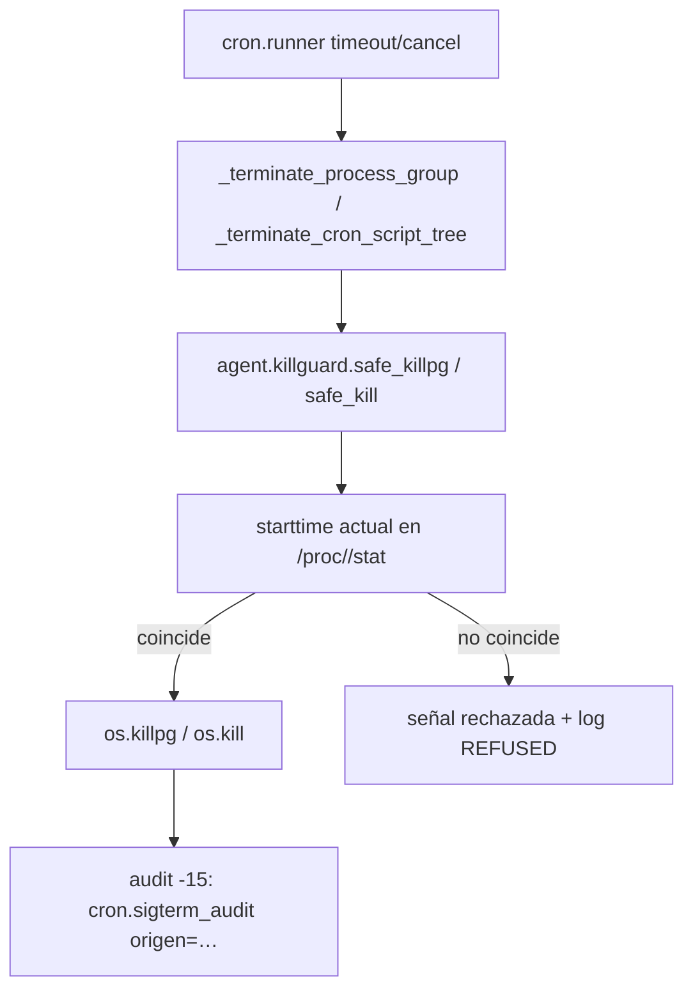

# Technical Design: HERMES-KILLGUARD — señalización con identidad verificada

* **Associated Spec**: [01-spec.md](./01-spec.md)
* **Status**: Completed
* **Architect**: Ragnar
* **Target Revision**: `fix/killguard-sigterm` (ronda 2, post-review)

---

## 1. Architecture Overview & Component Boundaries



`agent/killguard.py` es el único módulo que toca `os.killpg`/`os.kill` con señales de
terminación; `cron/scheduler_script.py` y `agent/deadline.py` solo lo invocan.

## 2. Public Interfaces & Contracts

```python
def proc_starttime(pid: int) -> Optional[int]: ...
def _caller(limit: int = 10) -> str: ...
def log_signal(site: str, pid: Optional[int], pgid: Optional[int],
               starttime: Optional[int]) -> None: ...
def safe_killpg(pgid: int, sig: int, *, expected_starttime: Optional[int] = None,
                site: str = "") -> bool: ...   # fail-open si no hay starttime
def safe_kill(pid: int, sig: int, *, expected_starttime: Optional[int] = None,
              site: str = "") -> bool: ...     # fail-closed si no hay starttime
def _registrar_pid_senalado(pid: int) -> None: ...  # en cron/scheduler_script.py
```

Contrato: `True` solo si la señal salió de verdad; cada rechazo emite `killguard: REFUSED|refused|DEGRADED …`
con `site`, `sig` y `caller=`.

## 3. Data Schema & State Invariants

* `_PIDS_SENALADOS: set[int]` + `_PIDS_SENALADOS_MAX = 4096` en `cron/scheduler_script.py`.
  Solo se registra un pid **después** de entregar la señal (evita falso positivo de "runner"
  cuando el guard rechazó el kill); al llegar al techo se vacía (registro heurístico).

## 4. Trade-Offs & Alternatives Considered

* **Approach A (Selected)**: guardar `starttime` en el sitio de llamada y revalidarlo al matar.
  Cero dependencias, cero overhead (dos lecturas de `/proc` por kill).
* **Approach B (Discarded)**: capturar `starttime` en el spawn y revalidar contra ese valor —
  descartado por un falso negativo posible si el spawn y el kill se hacen en instantes
  distintos con procesos efímeros; el valor del sitio de llamada es el que el código ya usa.
* **Approach C (Discarded)**: matar siempre con `SIGKILL` directo — eliminaría el timeout
  con gracia y no resuelve el reciclaje (el PID sigue mal).
* **fail-open en `safe_killpg` vs fail-closed en `safe_kill`**: el primero evita dejar vivo un
  árbol que el runner está parando (ya tiene grupo protegido como red); el segundo no tiene
  respaldo de grupo, así que prefiere no matar.

## 5. Observability & Error Handling

* `INFO`: `killguard: <site> pid=… pgid=… starttime=… caller=…` por cada intento.
* `WARNING`: `REFUSED … leader recycled`, `refused … is protected`, `DEGRADED … fail-open`,
  y `cron.sigterm_audit: script=… pid=… pgid=… origen=… duracion=… gateway_pid=…` en `-15`.
* Los `except Exception` amplios de lectura (`/proc`, `traceback`) loguean a `DEBUG` antes de
  devolver `None`/`"?"`; los `OSError` de entrega loguean `WARNING` distinguiendo
  `ProcessLookupError` (proceso ya no está) de `PermissionError`/otros.

## 6. Skill Pattern Compliance

* **Referenced Skills**: `.skills/code-review-and-quality/SKILL.md`.
* **Enforced Patterns**: type hints obligatorios en todo `killguard.py`, docstrings con
  Args/Returns, logging estructurado, `ruff`/`py_compile` limpio, pruebas deterministas sin red.
* **Anti-Patterns Avoided**: `except: pass` sin log, estado global sin techo, código muerto sin
  documentar el invariante, atribución de IA en commits, cambios fuera de los 4 archivos.
