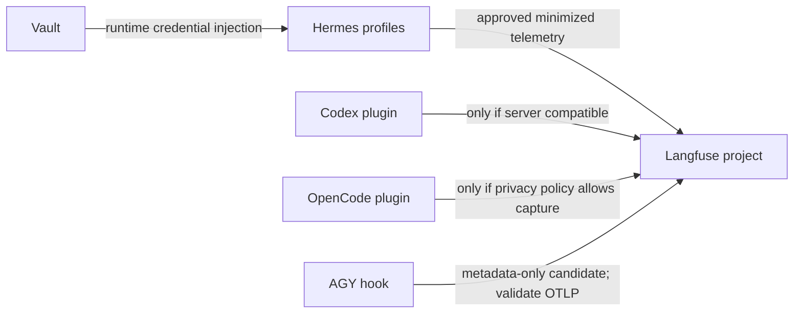

# Technical Design: Langfuse Fleet Observability

* **Associated Spec**: [01-spec.md](./01-spec.md)
* **Status**: Draft — implementation decisions gated by compatibility, privacy, and operator ownership
* **Architect**: Codex
* **Target Revision**: `feat/langfuse-fleet-observability`

---

## 1. Architecture Overview & Component Boundaries

Keep this as an integration/operations change at existing telemetry edges; do not widen Hermes core. There are two distinct Hermes paths: the selected per-profile catalog plugin uses SDK4 in PM-managed Python 3.14; the bundled legacy implementation uses SDK2 and a separate lazy-package fallback. Separate importability, alias enablement, event emission, and server ingestion as distinct evidence points.

No client is considered operational based only on an installed SDK, enabled config, or successful import. The selected SDK4 runtime imports, but the deployed server `2.95.11` is below the documented SDK v3/v4 minimum `3.63.0`. For activation phases only, verify a positive canary in the intended project after naming and authorizing the environment; the canary must contain no sensitive content. Inventory and documentation work emit no trace.

## 2. Public Interfaces & Contracts

No new Hermes public API is approved by this design. Use existing integration points only after inspection and approval of exact edit surfaces. External integrations must document their required server and SDK versions, data fields emitted, credential source, enable/disable control, and rollback method before activation.

## 3. Data Schema & State Invariants

- Preserve exact existing pins unless a separately approved change provides an exact version and compatibility rationale.
- Never log or document API-key values. Reference only a secret's logical name or Vault path when necessary and safe.
- Minimize to operational metadata by default. Prompt text, model outputs, tool arguments/results, and user identifiers remain excluded until explicitly approved.
- A profile/service map is an explicit inventory artifact; names of systemd units alone do not establish profile binding.
- For telemetry activation, a positive ingestion result is observed evidence tied to the intended project and named, authorized environment; the canary contains no sensitive content and only redacted evidence is recorded.
- `HERMES_LANGFUSE_CAPTURE` accepts `metadata`, `sanitized`, and `full`; its default `sanitized` mode is not content-free. Effective per-profile configuration is unknown and must be audited before activation.
- Modern `langfuse` and legacy `observability/langfuse` aliases coexist. This is a duplication risk, not evidence of duplicate trace emission.

## 4. Trade-Offs & Alternatives Considered

| Approach | Decision | Trade-off |
|---|---|---|
| Migrate Langfuse server for selected SDK4/OTLP | Requires explicit user decision and separate authorization | Provides a compatible SDK4 server path; migration and rollback risk remain. |
| Adapt modern integration APIs to the legacy server route | Requires explicit user decision and design validation | Not a simple SDK downgrade; does not provide native Codex OTLP support on server v2. |
| Enable OpenCode plugin as-is | Blocked pending privacy decision | Official plugin captures prompts/tool payloads; no proven metadata-only mode. |
| AGY metadata hook before OTLP validation | Candidate only | May minimize payload, but does not prove native OTLP export or ingestion compatibility. |

## 5. Observability & Error Handling

Treat these as separate results: SDK import, integration initialization, profile/service enablement, event emission, and server ingestion. Report the exact failing layer and a redacted error category. If an applicable check for the current phase is unavailable or ambiguous, leave that phase pending; do not claim success or retry a mutating operation blindly.

## 6. Compatibility Evidence & References

Corrected inventory: the selected official catalog plugin is version `2.0.0`, source commit `c2a95963c442f3f23e4bc6fe0da898e1dd1fb63d`, and pins `langfuse==4.15.2`. DEV PM generation `2852166f2cb3454db180810e2f3d29ef` uses Python `3.14.7`, SDK `4.15.2`, and pydantic-core `2.46.4`; the independent reviewer directly verified its import (exit 0). PROD PM generation `36f4b27c…` was reported to import the same stack by the diagnostic worker, not independently by the reviewer. The server is `2.95.11`, below the documented `3.63.0` SDK v3/v4 minimum. The legacy bundled SDK `2.60.10` lazy-package path contains CPython 3.13 extensions and fails under Python 3.14, but this is separate from the selected PM runtime and is not the active global root cause. Alias counts are DEV: short `langfuse` enabled 8 and legacy `observability/langfuse` enabled 10; PROD: short `langfuse` enabled 8 and legacy alias enabled 11. Roots are disabled; two PROD test profiles are unconfigured. Alias coexistence does not prove duplicate traces.

Official references:
- [Langfuse Codex integration](https://langfuse.com/integrations/developer-tools/codex)
- [Langfuse OpenCode integration](https://langfuse.com/integrations/developer-tools/opencode)
- [Codex plugin supported versions](https://github.com/langfuse/codex-observability-plugin#supported-versions)
- [Langfuse self-hosted versioning](https://langfuse.com/self-hosting/upgrade/versioning)
- [Codex config reference](https://learn.chatgpt.com/docs/config-file/config-reference)
