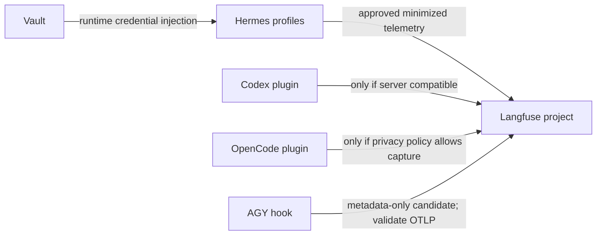

# Technical Design: Langfuse Fleet Observability

* **Associated Spec**: [01-spec.md](./01-spec.md)
* **Status**: Draft — implementation decisions gated by compatibility, privacy, and operator ownership
* **Architect**: Codex
* **Target Revision**: `feat/langfuse-fleet-observability`

---

## 1. Architecture Overview & Component Boundaries

Keep this as an integration/operations change at existing telemetry edges; do not widen Hermes core. Separate package importability, profile enablement, event emission, and server ingestion as four distinct evidence points.

No client is considered operational based only on an installed SDK, enabled config, or successful import. A positive event must be verified in the intended project without recording its secret-bearing configuration.

## 2. Public Interfaces & Contracts

No new Hermes public API is approved by this design. Use existing integration points only after inspection and approval of exact edit surfaces. External integrations must document their required server and SDK versions, data fields emitted, credential source, enable/disable control, and rollback method before activation.

## 3. Data Schema & State Invariants

- Preserve exact existing pins unless a separately approved change provides an exact version and compatibility rationale.
- Never log or document API-key values. Reference only a secret's logical name or Vault path when necessary and safe.
- Minimize to operational metadata by default. Prompt text, model outputs, tool arguments/results, and user identifiers remain excluded until explicitly approved.
- A profile/service map is an explicit inventory artifact; names of systemd units alone do not establish profile binding.
- A positive ingestion result is observed evidence tied to the intended project and timestamp, with payload contents redacted.

## 4. Trade-Offs & Alternatives Considered

| Approach | Decision | Trade-off |
|---|---|---|
| Repair DEV using existing pins and correct ABI environment | Preferred first implementation gate | Lowest dependency and server risk; does not by itself solve integrations requiring Langfuse v3. |
| Upgrade shared server for Codex compatibility | Not authorized; requires explicit decision and rollout plan | Enables newer plugin support, but increases migration, service, compatibility, and rollback risk. |
| Enable OpenCode plugin as-is | Blocked pending privacy decision | Official plugin captures prompts/tool payloads; no proven metadata-only mode. |
| AGY metadata hook before OTLP validation | Candidate only | May minimize payload, but does not prove native OTLP export or ingestion compatibility. |

## 5. Observability & Error Handling

Treat these as separate results: SDK import, integration initialization, profile/service enablement, event emission, and server ingestion. Report the exact failing layer and a redacted error category. If any check is unavailable or ambiguous, leave the phase pending; do not claim success or retry a mutating operation blindly.

## 6. Compatibility Evidence & References

Inventory evidence supplied for this plan: DEV Python `3.14.7`, Pydantic `2.13.4` / core `2.46.4`; PROD Python `3.14.7`, Pydantic `2.13.5` / core `2.46.5`; Langfuse SDK `2.60.10` on both; PROD server `2.95.11` (image digest `85c278dcab96c15db94191a5c1664f85aba2d7fb6771a00e99681c902c4b7015`). DEV Codex `0.163.0`, OpenCode `1.18.35`, AGY `1.4.0`; PROD Codex absent, OpenCode `1.18.18`, AGY `1.1.14`. The lazy-package tree contains CPython 3.13 extensions; imports fail in the active CPython 3.14 runtime.

Official references:
- [Langfuse Codex integration](https://langfuse.com/integrations/developer-tools/codex)
- [Langfuse OpenCode integration](https://langfuse.com/integrations/developer-tools/opencode)
- [Codex plugin supported versions](https://github.com/langfuse/codex-observability-plugin#supported-versions)
- [Langfuse self-hosted versioning](https://langfuse.com/self-hosting/upgrade/versioning)
- [Codex config reference](https://learn.chatgpt.com/docs/config-file/config-reference)
