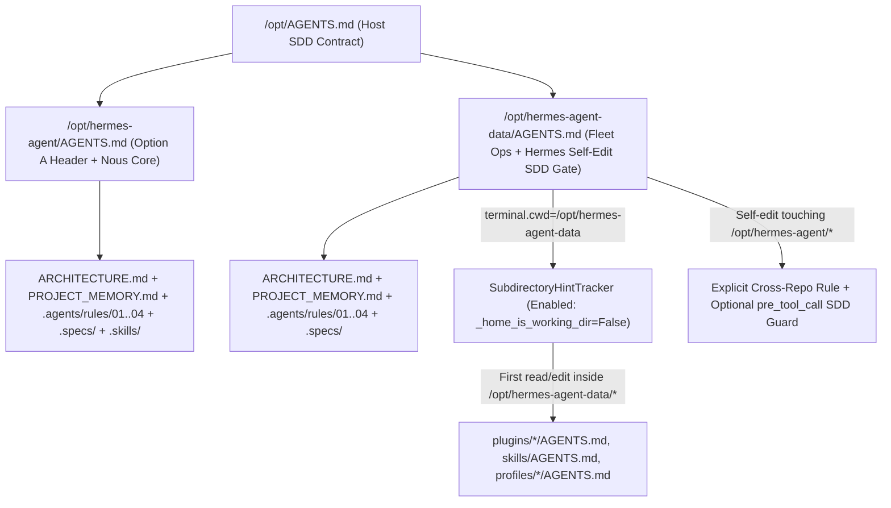

# Technical Design: Unified SDD Governance Across `/opt/hermes-agent` and `/opt/hermes-agent-data`

* **Associated Spec**: [01-spec.md](./01-spec.md)
* **Status**: Completed
* **Architect**: Antigravity Architect
* **Target Revision**: `/opt/hermes-agent` `prod-stable` (`6f1af4d1a7`) + `/opt/hermes-agent-data` `master` (`f9ad6a8`)

---

## 1. Architecture Overview & Discovery Flow

---

## 2. Exact Changes by Component

### A. `/opt/hermes-agent` (Core Repo)
1. **`/opt/hermes-agent/AGENTS.md` (Option A Header Block)**:
   * Prepend a compact (~25 lines) `## NeuralCrew Labs — SDD Governance & Repo Boundary` block at line 1, keeping the total file well below `12,000` chars (currently `11,450` chars -> keep total `~13k` or trim redundant whitespace if needed, noting `prompt_builder.py` default per-file cap; let's check `_truncate_content` limit before Phase 4 so nothing gets truncated!).
   * Explicitly mandate:
     1. Pre-flight read of `PROJECT_MEMORY.md`, `ARCHITECTURE.md`, `.agents/rules/01-sdd-workflow.md`..`04-memory-and-reuse.md`, `.atl/skill-registry.md`, and active `.specs/`.
     2. 4-phase SDD gate before non-trivial code changes.
     3. Skill isolation: use `.skills/` (15 repo engineering skills), NEVER bulk-load `skills/` (bundled fleet catalog).
     4. Cross-repo map: runtime config, profiles, crons, and user-installed plugins (including **Pre-Lector Cognitivo** in `plugins/typesafe-skill-router/`) live in `/opt/hermes-agent-data/`.
   * Preserve all existing Nous sections (`lines 1-164`) unmodified below the header.
2. **`/opt/hermes-agent/ARCHITECTURE.md` (New File)**:
   * Concise architectural map of Hermes core (`agent/`, `gateway/`, `hermes_cli/`, `tools/`, `plugins/`, `scripts/hooks/`), KV-cache invariants (`prompt_builder.py` 3-tier system prompt), plugin isolation (`in_process` vs `child`), and Reusable Code Catalog (`PluginLlm`, `MemoryStore`, `SubdirectoryHintTracker`, `hook_output_spill`).
3. **`/opt/hermes-agent/.agents/rules/03-code-standards.md`**:
   * Reconcile test command conflict: specify `scripts/run_tests.sh` for Hermes core suites (`AGENTS.md:138`) and `/usr/local/bin/pytest` / repo runner only for standalone plugins or isolated tools.

### B. `/opt/hermes-agent-data` (Runtime & Fleet Repo)
1. **`/opt/hermes-agent-data/.agents/rules/01-sdd-workflow.md` .. `04-memory-and-reuse.md` (New Files)**:
   * Tailored to `/opt/hermes-agent-data` scope: `.specs/` for runtime/ops/scripts/crons/fleet changes, `skills/` consolidation rules, zero-secrets (`vw` / `.env` `0600`), and `hermes:hermes` ownership.
2. **`/opt/hermes-agent-data/PROJECT_MEMORY.md` & `/opt/hermes-agent-data/ARCHITECTURE.md` (New Files)**:
   * `ARCHITECTURE.md`: Maps systemd services (`hermes-agent.service`, `hermes-agent-roshi.service`, `hermes-dashboard.service`), 11 profiles, `$HERMES_HOME/plugins/` (including `typesafe-skill-router` / **Pre-Lector Cognitivo**), `/opt/hermes-agent-data/skills/` SSOT, and `/opt/hermes-agent` core boundary.
   * `PROJECT_MEMORY.md`: Tracks runtime/ops initiatives and recent milestones (e.g., `2026-11-15` skill catalog consolidation, `2026-11-17` SDD governance unification & **Pre-Lector Cognitivo** audit).
3. **`/opt/hermes-agent-data/AGENTS.md`**:
   * Fix stale line 5 pointer (`/opt/hermes-agent/skills/` -> `/opt/hermes-agent-data/skills/` for live fleet catalog).
   * Add explicit **Hermes Self-Editing SDD Gate**:
     - Allowed without `.specs/`: appending dated facts to `memories/MEMORY.md` / `engram`, or routine cron state updates.
     - Requires SDD (`01-spec.md` -> `02-design.md` -> `03-tasks.md` + approval): modifying `AGENTS.md`, `config.yaml`, `scripts/*.py`, `plugins/*`, `profiles/*/AGENTS.md`, or any file inside `/opt/hermes-agent/`.
   * Keep the `## Protocolo Inviolable de Repositorios Vivos y Desarrollo SDD` block pointing to files that now **actually exist** in `/opt/hermes-agent-data`.
4. **Deduplicate `profiles/*/AGENTS.md`**:
   * Replace duplicated 7-line SDD blocks in `profiles/{roshi,vigia,...}/AGENTS.md` (if present) with a 1-line pointer to `/opt/hermes-agent-data/AGENTS.md` + `.agents/rules/01-sdd-workflow.md` (or keep profile-specific role overrides only).
5. **`/opt/hermes-agent-data/.gitignore`**:
   * Add whitelist entries (`!/.agents/`, `!/.agents/rules/`, `!/.agents/rules/*.md`, `!/PROJECT_MEMORY.md`, `!/ARCHITECTURE.md`, `!/.specs/README.md`, `!/.specs/sdd-governance-unification/`, `!/.specs/sdd-governance-unification/*`) so SDD artifacts are tracked cleanly.

### C. Hermes Daemon `SubdirectoryHintTracker` & Self-Edit Protection
1. **`config.yaml` (`terminal.cwd`)**:
   * Change `terminal.cwd: .` (`config.yaml:80`) to `terminal.cwd: /opt/hermes-agent-data` (and inspect `profiles/*/config.yaml` for any `terminal.cwd: .` overrides).
   * Effect: `TERMINAL_CWD` becomes `/opt/hermes-agent-data` instead of `Path.home()` (`/opt/hermes-agent-data/home`), flipping `SubdirectoryHintTracker._home_is_working_dir` from `True` to `False` and enabling automatic subdirectory `AGENTS.md` injection whenever Hermes accesses `plugins/typesafe-skill-router/`, `skills/`, `profiles/`, or `scripts/`.
2. **Cross-Tree SDD Guard Hook (`scripts/hooks/guard_sdd_cross_repo.py` — Optional/Recommended in Phase 3)**:
   * Because `SubdirectoryHintTracker._within_working_dir()` still blocks `/opt/hermes-agent/*` when `working_dir=/opt/hermes-agent-data`, evaluate a lightweight read-only `pre_tool_call` reminder/guard for `patch`/`write_file` targeting `/opt/hermes-agent/` or `/opt/hermes-agent-data/{plugins,scripts,profiles/*/AGENTS.md}` if `AGENTS.md`/`01-spec.md` has not been read in the session (reusing the pattern of `scripts/hooks/guard_read_before_patch.py`).

---

## 3. Trade-Offs & Alternatives Considered
* **Approach A (Selected)**: Prepend a concise SDD header to `/opt/hermes-agent/AGENTS.md` + mirror full SDD scaffolding in `/opt/hermes-agent-data/` + set `terminal.cwd: /opt/hermes-agent-data`. Universal across Hermes, Codex, OpenCode, and AGY, without shadowing Nous rules.
* **Approach B (Rejected)**: `AGENTS.override.md` in `/opt/hermes-agent/`. Shadows `AGENTS.md` completely in Hermes and Codex and may be ignored by other tools.
* **Approach C (Rejected)**: Duplicating `/opt/hermes-agent-data/.agents/rules` via symlinks to `/opt/hermes-agent/.agents/rules`. Breaks because `/opt/hermes-agent` rules target core Python/.skills (`scripts/run_tests.sh`), whereas `/opt/hermes-agent-data` rules target fleet ops/plugins/profiles.

---

## 4. Verification Strategy
* Verify `build_context_files_prompt(cwd="/opt/hermes-agent")` and `build_context_files_prompt(cwd="/opt/hermes-agent-data")` load the expected `AGENTS.md` without truncation warnings.
* Verify `SubdirectoryHintTracker("/opt/hermes-agent-data")._home_is_working_dir is False` and `check_tool_call("read_file", {"path": "/opt/hermes-agent-data/plugins/typesafe-skill-router/__init__.py"})` returns `plugins/typesafe-skill-router/AGENTS.md`.
* Verify every path referenced in both `AGENTS.md` files exists on disk (`test -f`) and retains `hermes:hermes` ownership.
