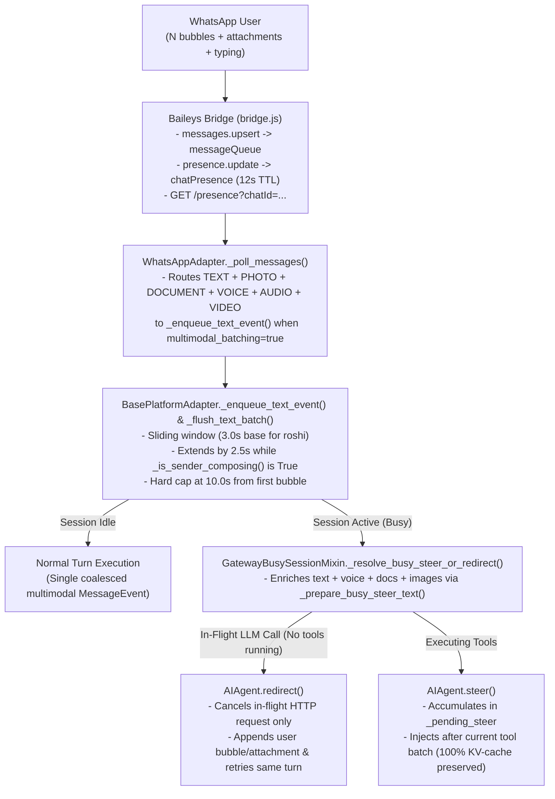

# Technical Design: WhatsApp Multi-Bubble Coalescing, Typing-Presence Extension & Multimodal Busy Redirect/Steer

* **Associated Spec**: [01-spec.md](./01-spec.md)
* **Status**: Approved
* **Architect**: Argon / Senior Architect
* **Target Revision**: `feat/ephemeral-progress-heartbeat-cleanup` (`9daf7b8fae`)

---

## 1. Architecture Overview & Component Boundaries



---

## 2. Public Interfaces & Contracts

### 2.1 Baileys Bridge Typing/Recording Presence (`scripts/whatsapp-bridge/bridge.js`)
Track per-chat typing/recording state with automatic TTL expiration and clear-on-message:

```javascript
const PRESENCE_TTL_MS = 12_000;
const chatPresence = new Map(); // key (JID / bare number) -> { state: string, updatedAt: number }
const subscribedPresenceChats = new Set();

function recordChatPresence(id, participant, state) {
  const now = Date.now();
  for (const rawKey of [id, participant]) {
    if (!rawKey) continue;
    const key = String(rawKey).trim();
    const bare = key.split('@')[0].split(':')[0];
    chatPresence.set(key, { state, updatedAt: now });
    if (bare) chatPresence.set(bare, { state, updatedAt: now });
  }
}
```
- On `sock.ev.on('presence.update', ({ id, presences }) => ...)`: updates `chatPresence` for `id` and each `participantJid` with `presence.lastKnownPresence`.
- On `messages.upsert`: clears `chatPresence` for `msg.key.remoteJid` and `senderJid` (since sending a bubble completes that typing action until a new `presence.update` arrives) and calls `sock.presenceSubscribe(msg.key.remoteJid)` once per chat session.
- `GET /presence?chatId=<jid>`: looks up `chatId` (and bare phone/LID alias) in `chatPresence` and returns `{ composing: boolean, state: string | null, ageMs: number | null }`, where `composing` is `true` iff `state === 'composing' || state === 'recording'` and `ageMs < PRESENCE_TTL_MS`.

### 2.2 Profile-Scoped Multimodal Batching & Presence Extension (`gateway/platforms/base.py` & `plugins/platforms/whatsapp/adapter.py`)
1. **Batching Ceilings & Defaults (`gateway/platforms/base.py`)**:
   - `_TEXT_BATCH_MAX_DELAY_S = 10.0` (up from `2.0`)
   - `_TEXT_BATCH_MAX_SPLIT_DELAY_S = 15.0` (up from `4.0`)
   - `_TEXT_BATCH_DEFAULT_PRESENCE_EXTEND_S = 0.0` (`_TEXT_BATCH_MAX_PRESENCE_EXTEND_S = 5.0`)
   - `_TEXT_BATCH_DEFAULT_HARD_CAP_S = 12.0` (`_TEXT_BATCH_MAX_HARD_CAP_S = 30.0`)
2. **Profile-Scoped Batch Overrides (`BasePlatformAdapter._batch_params_for_event`)**:
   - Resolves `profile = self._session_key_profile(event.source) or "default"`.
   - Reads optional `profile_batch_overrides.<profile>` from `self.config.extra` (falling back to adapter-level settings), returning `(delay_s, split_delay_s, presence_extend_s, hard_cap_s, multimodal_batching)`.
3. **Multimodal Merging in `_enqueue_text_event(self, event: MessageEvent)`**:
   - Stamps `existing._batch_first_ts = time.monotonic()` on first chunk.
   - Aligns `existing.media_text_inlined` with `existing.media_urls` before extending `media_urls` and `media_types`.
   - Preserves `MessageType.VOICE` when merging with `DOCUMENT` so STT still runs on voice attachments while `_prepend_inbound_document_notes` attaches document context notes.
   - Updates `existing.message_id` to the newest bubble's `message_id` so replies anchor to the final bubble in the burst.
4. **Presence-Aware Flush Loop in `_flush_text_batch(self, key: str)`**:
   - Sleeps for the quiet delay (`_text_batch_delay_for(pending)`).
   - While `presence_extend_s > 0` and `(now - first_ts) < hard_cap_s`:
     - Calls `await self._is_sender_composing(pending)`.
     - If `True`, sleeps `min(presence_extend_s, hard_cap_s - (now - first_ts))` and re-checks (aborting if a newer chunk replaced the task).

### 2.3 Multimodal Mid-Turn `redirect` + `steer` (`gateway/run_busy.py` & `gateway/run_inbound.py`)
1. **Multimodal `_prepare_busy_steer_text(self, event: MessageEvent, session_key: Optional[str] = None) -> str`**:
   - Under `self._profile_scope_for_source(event.source)`:
     - Calls `rehome_inbound_media(event)` when `event.media_urls` is present.
     - Classifies attachments via `self._classify_inbound_media(event, getattr(event, "_gateway_pending_stt_prepared", False))`.
     - Transcribes voice attachments via `_transcribe_and_echo_pending_voice`.
     - Prepends document context notes (`_prepend_inbound_document_notes`) and audio/video file notes (`_prepend_inbound_media_file_notes`).
     - Handles image attachments (`image_paths`): if `session_key` is provided and `_decide_image_input_mode` is `"native"`, appends `image_paths` to `self._session_state(session_key).persistent.native_image_paths` AND prepends a path note `[The user attached image(s): ...]` so both `redirect` and mid-turn `steer` expose the image to the agent.
2. **Auto-`redirect` Before `steer` in `_resolve_busy_steer_or_redirect`**:
   - When `effective_mode == "steer"` and `steer_text` is non-empty and `agent_live`:
     - Checks if the agent is currently inside an active model API call (not executing tools):
       `getattr(running_agent, "_supports_active_turn_redirect", False) is True and hasattr(running_agent, "redirect") and not getattr(running_agent, "_executing_tools", False)`
     - If so, calls `redirected = self._redirect_active_turn(running_agent, steer_text, session_key, event)`.
     - If `not redirected` (e.g. tools are currently executing or `_model_request_active` is not set), calls `steered = self._try_agent_verb(running_agent, "steer", steer_text, session_key, event=event)`.

### 2.4 Shared-Transport Profile Route Resolution (`gateway/run.py`)
In `GatewayRunner._profile_name_for_source` (`gateway/run.py:4525-4537`):
- When `matched.profile not in served`: if `adapter_profile is None` (shared primary adapter) and `profile_exists(matched.profile)` is `True` and the target profile does not run its own enabled adapter for `source.platform`, permit the route so shared-bridge WhatsApp traffic (`chucho-wa-*` -> `roshi`) is served cleanly.

---

## 3. Data Schema & State Invariants
* `existing.media_urls`, `existing.media_types`, and `existing.media_text_inlined` maintain 1:1 index correspondence across N merged bubbles.
* `_batch_first_ts` is monotonic and immutable across task restarts for the same batch key until `_pop_text_batch(key)` drains the batch, guaranteeing the hard cap `text_batch_hard_cap_seconds` is strictly enforced even if the user sends 15 bubbles or stays in `composing`.

---

## 4. Trade-Offs & Alternatives Considered
* **Approach A (Selected — Sliding Multimodal Batch + Presence Extension with Hard Cap + Native `redirect`/`steer`)**:
  - Handles both pre-turn bursts and mid-turn follow-ups across N bubbles and attachments without extra LLM classification calls or prompt-cache invalidation.
* **Approach B (Discarded — Parallel LLM Classifier Pausing Tool Execution)**:
  - Breaks provider KV-cache prefixes, adds LLM latency/cost per bubble, and risks deadlocking tool worker threads.

---

## 5. Observability & Error Handling
* `WhatsAppAdapter._is_sender_composing` fails open (`False`) on HTTP timeout (`1.5s`) or bridge error so message delivery is never blocked by presence failures.
* Logs batch flush details including bubble count, char length, media count, and elapsed wait time (`Flushing text batch %s (%d chars, %d media, %d chunks)`).

---

## 6. Skill Pattern Compliance
* **Referenced Skills**:
  - `.skills/api-and-interface-design/SKILL.md`
  - `.skills/code-review-and-quality/SKILL.md`
* **Enforced Patterns**: Backward-compatible configuration defaults (`0.3s` default preserved for unconfigured profiles; `roshi` explicitly configured), zero KV-cache prefix mutation, and deterministic hard caps.
